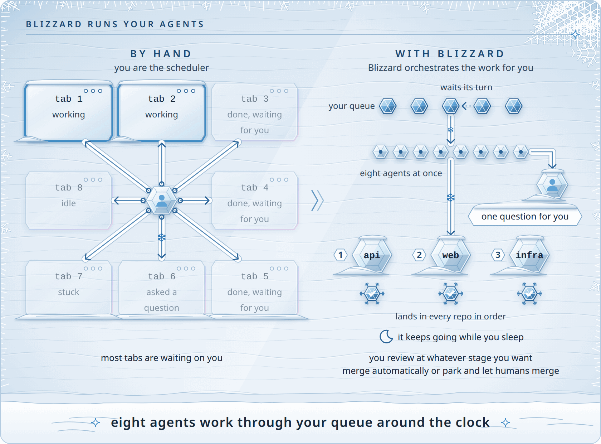
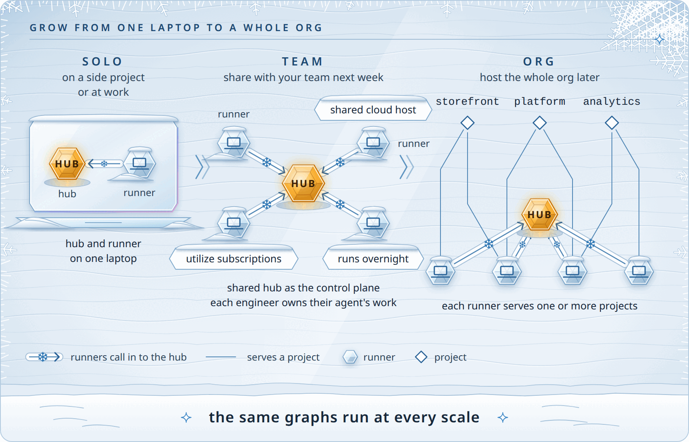
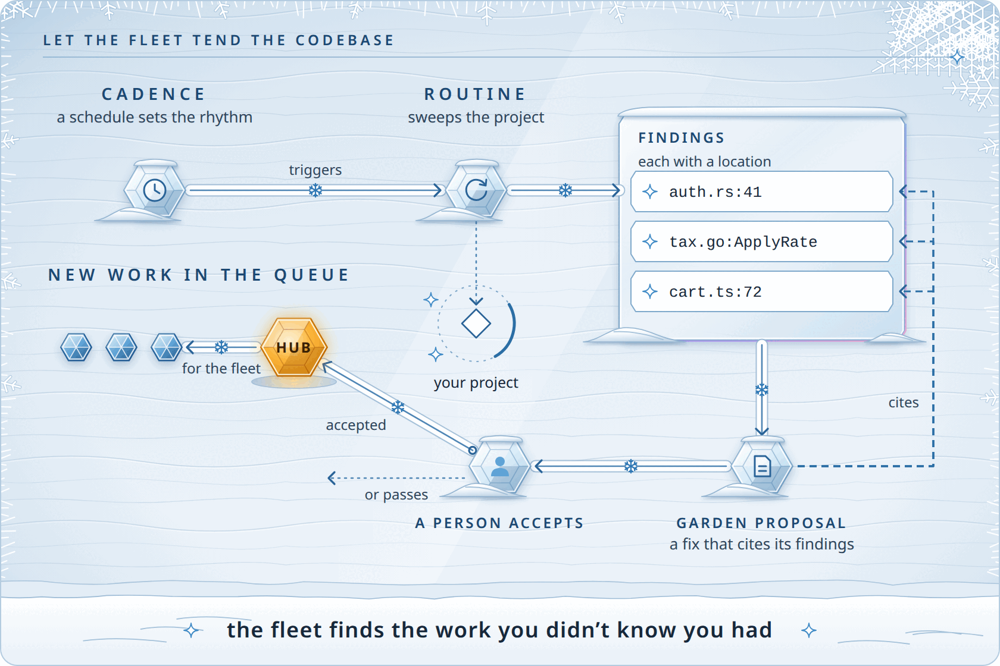

<h1 align="center">
  <picture>
    <source media="(prefers-color-scheme: dark)" srcset="docs/identity/logo-hubflake.svg">
    
  </picture><br>
  Blizzard
</h1>

<p align="center">
  <strong>An orchestration platform for autonomous fleets of coding agents.</strong>
</p>

<p align="center">
  <a href="https://github.com/paul-gross/blizzard/releases"></a>
  
  
</p>

<p align="center"><sub><strong>Status: pre-1.0.</strong> Blizzard is built on its own fleet every day, and a minor release may
still carry a breaking change (<a href="./docs/versioning.md">versioning</a>).</sub></p>

<p align="center"><sub>Project Blizzard is the prototype name for the fleet orchestration module that will become part of
the Winter platform.</sub></p>

You queue work from your backlog, and runners on your own machines carry it through a workflow graph you control. The
code lands, or the fleet stops and tells you exactly where it needs you and why. Blizzard is designed to help developers
and organizations move from **human in the loop** to **human on the loop**, one gate at a time.

<p align="center">
  <picture>
    <source media="(prefers-color-scheme: dark)" srcset="docs/media/hero-tabs-dark.png">
    
  </picture>
</p>

<p align="center">
  <a href="./docs/index.md">Operator docs</a> ·
  <a href="./docs/install.md">Install guide</a> ·
  <a href="./docs/verifying.md">Verifying a release</a> ·
  <a href="./SECURITY.md">Security policy</a>
</p>

## Blizzard's focus

We provide the tool that mechanizes handing work to agents, deterministically. Anything outside that mission is
deliberately yours to control.

Blizzard assumes a capable agent, dropped into your workspace, can follow the conventions your repos already have: how
they build, how they test, what "done" means. So that knowledge stays in your repos, not in Blizzard. What Blizzard owns
is the part an agent can't be trusted with just by being good at its job: delivering exactly once, recovering from a
crash, keeping spend in check, and keeping a truthful record of what happened.

<p align="center">
  <picture>
    <source media="(prefers-color-scheme: dark)" srcset="docs/media/pillar-scope-dark.png">
    
  </picture>
</p>

## Engineer the loop around the agents

You decide how work moves through your agents by writing a workflow graph: plan, build, verify, review, deliver, or
whatever steps your team actually uses. Blizzard comes with a few ready-made graphs you can start from and tweak.

When a step finishes, the agent picks an outcome, like pass or fail, and the graph decides what happens next. If verify
or review fails, the work goes back to build to get fixed. Reviews start a fresh session so they look at the code with
fresh eyes, while build picks up where it left off so it remembers what it already tried.

Nothing merges until your CI passes, so "the tests pass" means CI said so, not the agent. And when an agent gets stuck
and needs you, `blizzard runner takeover <chunk>` opens that agent's session right in your terminal so you can jump in.

<p align="center">
  <picture>
    <source media="(prefers-color-scheme: dark)" srcset="docs/media/pillar-loop-dark.png">
    
  </picture>
</p>

## Grow from one laptop to a whole org

You can start alone, on a side project or on the repo you work on. The **hub** is the control plane that holds the queue
and the workflow graphs, and a **runner** is the daemon that runs coding agents on its own machine. A hub and a runner
on one laptop, on the default SQLite store, is a complete deployment.

When your team wants in, you move the hub to a shared host or a cloud machine. Each engineer runs their own runner and
owns their agents' work, and those agents run on the subscriptions the engineer already pays for. An org splits its work
into projects, and each runner serves one or more of them.

Runners always call the hub, and the hub never reaches into a machine. Tenants, SSO and roles are there when an operator
needs them, as the [deployment docs](./docs/deployment.md) describe.

<p align="center">
  <picture>
    <source media="(prefers-color-scheme: dark)" srcset="docs/media/pillar-scale-dark.png">
    
  </picture>
</p>

## Land changes in multiple repos

A **chunk** is the unit of work. One chunk holds every repository a change touches, and the runner gives it an
environment with its own worktree of each. At delivery, each repository lands under its own landing policy, in the order
its project sets, and the hub records each landing so a retry never lands a repository twice.

A runner holds a chunk under a lease, and each lease carries an epoch. A stale worker can never overwrite its
successor's delivery, and a `kill -9` at any moment loses at most the tokens in flight. Missing CI checks, a
branch-protection refusal, or a pull request closed without merging escalates to a person instead of being bypassed.

<p align="center">
  <picture>
    <source media="(prefers-color-scheme: dark)" srcset="docs/media/pillar-landing-dark.png">
    
  </picture>
</p>

## Gardening

A **routine** sweeps your project along an axis you define, and records each problem it finds as a **finding** with its
location. A finding stays live until a later run sees it gone or a person closes it.

The fleet then writes **proposals** that cite the findings behind them. A person accepts or declines each one, and an
accepted proposal becomes a work item for the fleet. When that work lands, the findings it answered close, and the
routine's next run checks that they stay closed.

Each finding records the commit that introduced it. From there you can trace it back to the chunk that landed that
commit, the graph that let it through, and the runner that did the work. That gives frontier agents what they need to
find the root cause of the weeds that grow in through everyday engineering.

<p align="center">
  <picture>
    <source media="(prefers-color-scheme: dark)" srcset="docs/media/pillar-garden-dark.png">
    
  </picture>
</p>

## Quickstart

Blizzard installs from each release's hashed requirements file, because there is no package index. These steps take you
from nothing to a hub with a runner pulling work, on one machine:

```bash
v=0.3.0
curl -fsSLO "https://github.com/paul-gross/blizzard/releases/download/v$v/blizzard-$v-requirements.txt"
uv venv --python 3.12 && uv pip sync --require-hashes "blizzard-$v-requirements.txt" && . .venv/bin/activate

mkdir hub && blizzard hub init hub    # config, data directory and a migrated SQLite store
blizzard hub host hub                 # serves the API and the board at http://127.0.0.1:8421/
```

From a second shell in the same directory, with the same virtualenv active, load the packaged graphs and set up a
runner:

```bash
blizzard hub graph sync                       # safe to re-run; run it again after every upgrade
mkdir runner && blizzard runner init runner   # scaffolds blizzard-host.toml and registers the runner at the hub
```

The runner starts agents with Claude Code by default, so it needs `claude` on your `PATH` and signed in. Give the
runner's workspace a repository to work in by adding this to the end of `runner/blizzard-host.toml`:

```toml
[[workspace.repo]]
name = "todo-mvc"
url = "https://github.com/you/todo-mvc.git"
```

In a third shell, from the same directory and virtualenv, start the runner:

```bash
blizzard runner host runner           # pulls work from the hub until you stop it
```

Back in the second shell, give it something to do. The built-in `hub` work source needs no forge and no credential, and
creating an item there also creates its chunk. A new chunk waits until you promote it:

```bash
echo "Add a CONTRIBUTING.md that says how to run the tests." |
  blizzard hub item create --title "Add a CONTRIBUTING.md" --body-file -
# created hub:1 → chunk ch_01…
blizzard hub chunk promote ch_01…
```

For the work to land on GitHub, the hub needs a record of the repository and a credential for it, which
[`docs/deployment/repositories.md`](./docs/deployment/repositories.md) covers. [`docs/install.md`](./docs/install.md)
covers everything else, starting with the Docker Compose deployment of a shared hub.

## Principles

**Harness engineering is the new core.** Every tool here exists to understand and control agent drift at each level.

**Built in the open.** Software factories should dogfood themselves, and anyone should be able to take the tour.
Blizzard builds Blizzard, and the quality of its own code is the guarantee of what it delivers.

**One tool at every level.** A solo developer on a side project and an architect at a large org use the same Blizzard.
What you learn on your own laptop carries straight over to your team and your company, so you can pick it up wherever
you are and grow into it.

**A deterministic shell.** The queue, the lease protocol, the reconciliation loop, the fencing and the crash recovery
are ordinary deterministic code.

**A human on the loop by default, and in the loop when you ask.** The packaged graphs run without stopping for anyone.
You step in on purpose.

**Isolated value over ecosystem lock-in.** The industry is moving too fast for one methodology to be worth adopting
whole.

## Contributing

Blizzard is built by Blizzard. Its own agents write the code, working through the same queue and graphs described above,
so there's no pull request queue to join. What moves it forward is ideas, plans and thoughts, and those are very
welcome. Reach out to share yours.

## License

Source-available under the Functional Source License 1.1 (FSL-1.1-ALv2). Each release converts to Apache License 2.0 two
years after it ships. See [LICENSE](./LICENSE).
